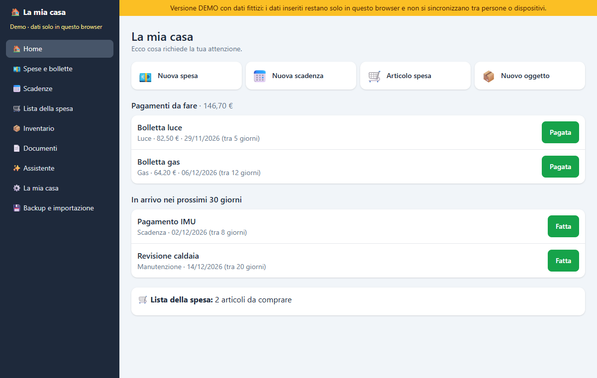

# Home e Car Manager

Gestionale di casa e auto. **Home**: spese e bollette, scadenze e manutenzioni, inventario, lista della spesa e documenti. **Car**: una o più auto con scadenze, interventi, rifornimenti, spese e documenti. Ogni persona ha il proprio account e i propri dati privati; un assistente facoltativo (Google Gemini) risponde sui dati che scegli di inviargli.

|  |  |  |

[Volantino A5](docs/home-car/volantino/volantino.pdf) · [Guida all'uso](docs/home-car/guida/guida.pdf) · [Accesso, sincronizzazione e chiave Gemini](docs/configurazione-supabase.md) · `npm run dev` / `npm run dev:demo`
