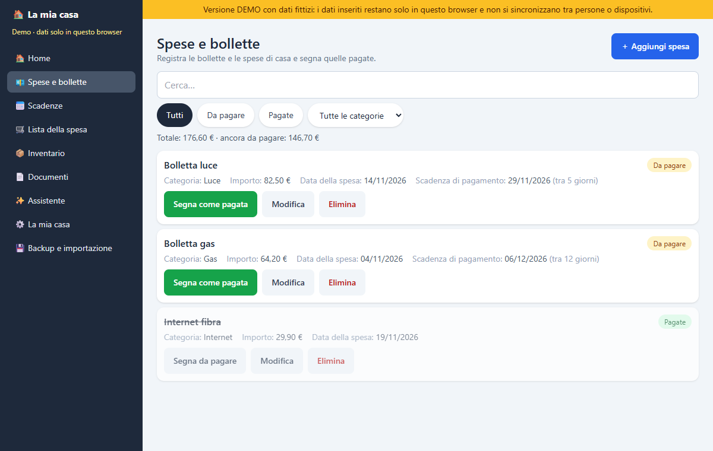

# Home Manager

Gestionale domestico: spese e bollette, scadenze e manutenzioni, inventario, lista della spesa e documenti della casa (titolo, scadenza e link), con un assistente che risponde sui propri dati.

> **La demo (`/demo/`) usa dati fittizi.** Nella demo non c'è nessun account: quello che inserisci resta solo nel tuo browser e **non** si sincronizza tra persone o dispositivi. Non è un archivio privato e non va usata per dati veri.

**[Apri l'app](https://andreapollastrelli95.github.io/home-manager-demo/)** (con account personali, da configurare una volta) · **[Prova la demo](https://andreapollastrelli95.github.io/home-manager-demo/demo/)**. Configurazione: [docs/configurazione-supabase.md](docs/configurazione-supabase.md).

| Home (demo) | Spese e bollette (demo) | Telefono (demo) |
|---|---|---|
|  |  |  |

## Due versioni

| | Demo | App con account |
|---|---|---|
| Accesso | nessuno | email e password (Supabase Auth) |
| Dati | fittizi, solo nel browser | veri, online, **una casa privata per ogni account** |
| Sincronizzazione | no | tra i dispositivi dello stesso account |
| Assistente AI | disattivato | facoltativo, con avviso sui dati inviati |
| Build | `npm run build:demo` | `npm run build` (serve la configurazione) |

Ogni persona (io, i miei zii, i miei genitori…) crea il **proprio account** e vede solo **la propria casa**: non esiste una casa condivisa e il database stesso, con Row Level Security, impedisce a un account di leggere i dati di un altro.

## Cosa fa

- **Home** con arretrati (in rosso), pagamenti da fare, scadenze in arrivo e azioni rapide.
- **Spese e bollette** per categoria, con scadenza e stato di pagamento; **scadenze e manutenzioni**; **inventario** per stanza; **lista della spesa**; **documenti** (solo metadati e link).
- Importi e date in formato italiano, schede leggibili su telefono, menu in basso, conferma prima di eliminare, ricerca e filtri, messaggi chiari su caricamento, errori e liste vuote.
- **Backup e importazione** JSON con controllo del file, anteprima e conferma. Nessun dato viene caricato in automatico nel nuovo account.
- Accesso: registrazione, login, uscita, recupero password, sessione che resta attiva. Stato di salvataggio sempre visibile.

## Avvio

```bash
npm install
npm run dev:demo      # demo con dati fittizi
npm run dev           # versione con login (richiede .env.local, vedi .env.example)
npm run build         # app con account → dist/   (senza configurazione mostra la schermata "da configurare")
npm run build:demo    # demo → dist/
npm run build:local   # uso personale con il server Node locale (senza account)
```

Per attivare gli account: crea un progetto [Supabase](https://supabase.com), esegui [`supabase/schema.sql`](supabase/schema.sql) e inserisci URL e chiave pubblica (*anon*) in `.env.local`. **Non** mettere mai la chiave `service_role` nell'app. Guida completa, pubblicazione su GitHub Pages e assistente AI: [docs/configurazione-supabase.md](docs/configurazione-supabase.md).

## Materiale da distribuire

- [Guida rapida per gli utenti (PDF)](docs/guida-rapida/guida-rapida.pdf) · sorgente `docs/guida-rapida/guida-rapida.html`, rigenerabile con `npm run guida`.
- Volantino A5 fronte/retro: bozza in `docs/volantino/volantino-bozza.pdf` (**senza QR**, perché l'app con login non è ancora pubblicata). Con l'indirizzo definitivo: `npm run volantino -- https://INDIRIZZO/ --verifica` crea il PDF con QR reale. Sorgente: `docs/volantino/volantino.template.html`.

## Come è fatto

React, TypeScript, Vite, Tailwind CSS, React Router (HashRouter) e Dexie (IndexedDB) per la demo; Supabase (Auth + Postgres con RLS) per la versione con account. Il codice dell'accesso è caricato solo nella versione con login. `supabase/verifica-rls.mjs` ripete in locale i controlli sulle regole di sicurezza. Il server Node (`server/`) e Electron (`electron/`) restano per l'uso personale in locale (`build:local`).

---

Progetto di [Andrea Pollastrelli](https://andreapollastrelli95.github.io/).
