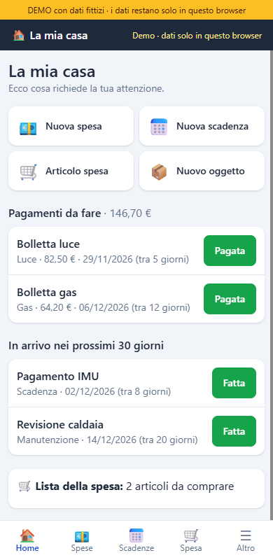

# Home Manager

Gestionale domestico: spese e bollette, scadenze e manutenzioni, inventario, lista della spesa e documenti della casa (titolo, scadenza e link), con un assistente che risponde sui propri dati.

|  |  |  |
